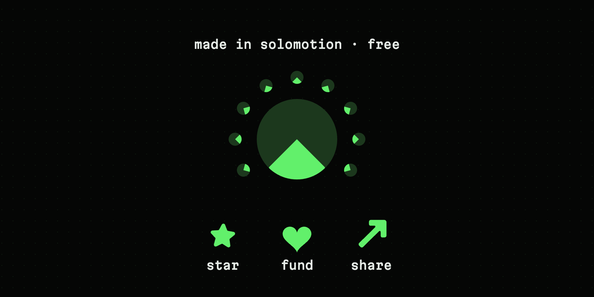
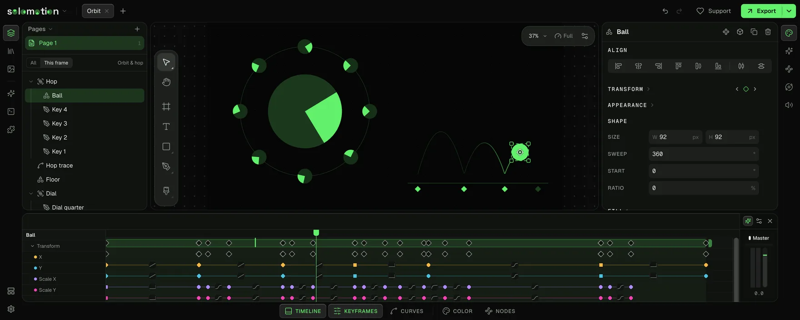
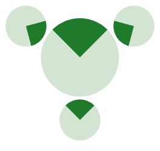

<p align="center">
  <picture><source media="(prefers-color-scheme: dark)" srcset="assets/logo-dark.png"></picture>
</p>

<p align="center">The free motion studio. Animate, edit and export in your browser.</p>

<p align="center">
  <a href="https://open.solomotion.app"><picture><source media="(prefers-color-scheme: dark)" srcset="assets/btn-open-dark.png"></picture></a>
  <a href="https://github.com/solocreates/solomotion"><picture><source media="(prefers-color-scheme: dark)" srcset="assets/btn-star-dark.png"></picture></a>
  <a href="https://github.com/sponsors/novincode"><picture><source media="(prefers-color-scheme: dark)" srcset="assets/btn-fund-dark.png"></picture></a>
  <a href="https://solomotion.app/docs"><picture><source media="(prefers-color-scheme: dark)" srcset="assets/btn-docs-dark.png"></picture></a>
</p>

<p align="center">
  <a href="https://open.solomotion.app">
    
  </a>
</p>
<p align="center"><sub>Made in SoloMotion.</sub></p>

<p align="center">
  <a href="https://github.com/solocreates/solomotion/stargazers"></a>
  
  
</p>

No account, no subscription, no watermark. Your projects stay on your machine.

## Open the studio

**[open.solomotion.app](https://open.solomotion.app)**. Nothing to install, free for good.

## The source opens at 1,000 stars

The whole studio is built and running: the engine, the editor, the agent
bridge, the desktop app. It goes public under AGPL-3.0, with its full history,
when this repo reaches **1,000 stars**.

Star it to count. Watch it to know the day.

<p>
  <a href="https://github.com/solocreates/solomotion"><picture><source media="(prefers-color-scheme: dark)" srcset="assets/btn-sup-star-dark.png"></picture></a>
</p>

## What's in it

**Keyframes on everything.** Every property animates, with curves, easing
presets, motion paths and expressions. The dope sheet and the curve editor
read the same keys.

<p align="center"></p>

**A real timeline.** Video, sound, captions and animation on one timeline.
Cut, trim, ripple, J and L cuts, transitions, tracking.

**Characters.** Bones, IK, poses, shape keys and lip sync. Frame-by-frame
drawing with onion skin when you want to draw it by hand.

**Looks.** Stacked effects, a node-based colour page, physics and particles,
and 3D worlds for scenes that need depth.

**Export.** MP4, WebM, GIF, MOV with alpha, PNG sequences and audio.

## Agents

Every action in the studio is a command in one registry, and agents get the
same commands over [MCP](https://modelcontextprotocol.io). An agent builds the
scene in the studio you have open. You watch, and undo its whole turn in one
step.

```sh
claude mcp add -s user solomotion -- npx -y @solomotion/mcp@latest
```

Then in the studio: **Agents › Use your agent app › Link**. Works with Claude
Code, Codex, Cursor and any MCP client.

## Support

<p align="center">The studio is free, and it stays free.</p>

<p align="center">
  <a href="https://github.com/solocreates/solomotion"><picture><source media="(prefers-color-scheme: dark)" srcset="assets/btn-sup-star-dark.png"></picture></a>
  <a href="https://github.com/sponsors/novincode"><picture><source media="(prefers-color-scheme: dark)" srcset="assets/btn-sup-sponsor-dark.png"></picture></a>
  <a href="https://buymeacoffee.com/codeideal"><picture><source media="(prefers-color-scheme: dark)" srcset="assets/btn-sup-coffee-dark.png"></picture></a>
</p>
<p align="center">
  <a href="https://x.com/intent/post?text=SoloMotion%3A%20a%20free%20motion%20studio%20in%20your%20browser.%20Its%20source%20opens%20at%201%2C000%20stars.&url=https%3A%2F%2Fgithub.com%2Fsolocreates%2Fsolomotion"><picture><source media="(prefers-color-scheme: dark)" srcset="assets/btn-sup-x-dark.png"></picture></a>
  <a href="https://bsky.app/intent/compose?text=SoloMotion%3A%20a%20free%20motion%20studio%20in%20your%20browser.%20Its%20source%20opens%20at%201%2C000%20stars.%20https%3A%2F%2Fgithub.com%2Fsolocreates%2Fsolomotion"><picture><source media="(prefers-color-scheme: dark)" srcset="assets/btn-sup-bluesky-dark.png"></picture></a>
  <a href="https://www.linkedin.com/sharing/share-offsite/?url=https%3A%2F%2Fsolomotion.app"><picture><source media="(prefers-color-scheme: dark)" srcset="assets/btn-sup-linkedin-dark.png"></picture></a>
</p>

## Supporters

Everyone who funds SoloMotion or makes something about it is listed here, in three rows:

- **First believers.** The first people to fund, post or make something about SoloMotion. This row is permanent.
- **Sponsors.** Monthly supporters.
- **Creators.** People who made a video, a tutorial, an article or a post.

The wall is empty today. [Sponsor](https://github.com/sponsors/novincode) or [tell us what you made](https://github.com/solocreates/solomotion/issues/new?template=3-made-something.yml) to be the first name on it.

<p>
  <a href="https://github.com/solocreates/solomotion/issues/new?template=3-made-something.yml"><picture><source media="(prefers-color-scheme: dark)" srcset="assets/btn-wall-dark.png"></picture></a>
</p>

## Feedback

Found a bug or want a feature? [Open an issue](https://github.com/solocreates/solomotion/issues/new/choose).
Questions go to [Discussions](https://github.com/solocreates/solomotion/discussions).

<br>

<p align="center">
  <a href="https://solomotion.app"><picture><source media="(prefers-color-scheme: dark)" srcset="assets/mark-moons-dark.png"></picture></a>
</p>

<p align="center">
  <a href="https://solomotion.app">solomotion.app</a> ·
  <a href="https://open.solomotion.app">Studio</a> ·
  <a href="https://solomotion.app/docs">Docs</a> ·
  <a href="https://github.com/solocreates/solomotion/discussions">Discussions</a>
</p>

<p align="center"><sub>Made by <a href="https://github.com/solocreates">solocreates</a>: tools for people who make things alone.</sub></p>
