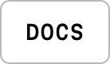
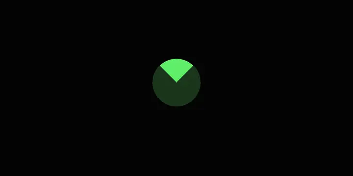
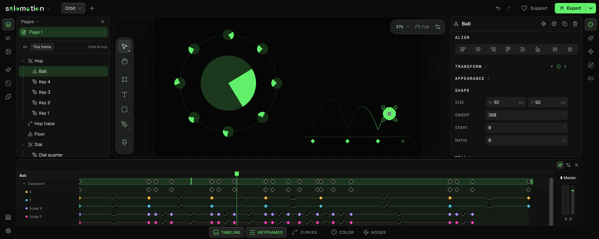

<p align="center">
  <picture><source media="(prefers-color-scheme: dark)" srcset="assets/logo-dark.png"></picture>
</p>

<p align="center">The open-source motion studio. Animate, edit and export in your browser.</p>

<p align="center">
  <a href="https://open.solomotion.app"><picture><source media="(prefers-color-scheme: dark)" srcset="assets/btn-open-dark.png"></picture></a>
  <a href="https://github.com/solocreates/solomotion"><picture><source media="(prefers-color-scheme: dark)" srcset="assets/btn-star-dark.png"></picture></a>
  <a href="https://github.com/sponsors/novincode"><picture><source media="(prefers-color-scheme: dark)" srcset="assets/btn-fund-dark.png"></picture></a>
  <a href="https://solomotion.app/docs"><picture><source media="(prefers-color-scheme: dark)" srcset="assets/btn-docs-dark.png"></picture></a>
</p>

<p align="center">
  <a href="https://solomotion.app">
    <picture>
      <source media="(prefers-reduced-motion: reduce)" srcset="assets/loop-poster.png">
      
    </picture>
  </a>
</p>
<p align="center"><sub>Made in SoloMotion.</sub></p>

<p align="center">
  <a href="LICENSE"></a>
  <a href="https://github.com/solocreates/solomotion/releases"></a>
  <a href="https://github.com/solocreates/solomotion/actions/workflows/ci.yml"></a>
</p>

No account, no subscription, no watermark. Your projects stay on your machine.

## Start

```sh
npx solomotion
```

Or open [open.solomotion.app](https://open.solomotion.app). Nothing to install.

## What's in it

**Keyframes on everything.** Every property animates, with curves, easing
presets, motion paths and expressions. The dope sheet and the curve editor
read the same keys.

<p align="center"></p>

**A real timeline.** Video, sound, captions and animation on one timeline.
Cut, trim, ripple, J and L cuts, transitions, tracking.

**Characters.** Bones, IK, poses, shape keys and lip sync. Frame-by-frame
drawing with onion skin when you want to draw it by hand.

**Looks.** Stacked effects, a node-based colour page, physics and particles,
and 3D worlds for scenes that need depth.

**Export.** MP4, WebM, GIF, MOV with alpha, PNG sequences and audio.

## Agents

Every action in the studio is a command in one registry, and agents get the
same commands over [MCP](https://modelcontextprotocol.io). An agent builds the
scene in the studio you have open. You watch, and undo its whole turn in one
step.

```sh
claude mcp add -s user solomotion -- npx -y @solomotion/mcp@latest
```

Then in the studio: **Agents › Use your agent app › Link**. Works with Claude
Code, Codex, Cursor and any MCP client.

## Support

<p align="center">Free, and it stays free.</p>

<p align="center">
  <a href="https://github.com/solocreates/solomotion"><picture><source media="(prefers-color-scheme: dark)" srcset="assets/btn-sup-star-dark.png"></picture></a>
  <a href="https://github.com/sponsors/novincode"><picture><source media="(prefers-color-scheme: dark)" srcset="assets/btn-sup-sponsor-dark.png"></picture></a>
  <a href="https://buymeacoffee.com/codeideal"><picture><source media="(prefers-color-scheme: dark)" srcset="assets/btn-sup-coffee-dark.png"></picture></a>
</p>
<p align="center">
  <a href="https://x.com/intent/post?text=SoloMotion%3A%20a%20free%2C%20open-source%20motion%20studio%20in%20your%20browser.&url=https%3A%2F%2Fsolomotion.app"><picture><source media="(prefers-color-scheme: dark)" srcset="assets/btn-sup-x-dark.png"></picture></a>
  <a href="https://bsky.app/intent/compose?text=SoloMotion%3A%20a%20free%2C%20open-source%20motion%20studio%20in%20your%20browser.%20https%3A%2F%2Fsolomotion.app"><picture><source media="(prefers-color-scheme: dark)" srcset="assets/btn-sup-bluesky-dark.png"></picture></a>
  <a href="https://www.linkedin.com/sharing/share-offsite/?url=https%3A%2F%2Fsolomotion.app"><picture><source media="(prefers-color-scheme: dark)" srcset="assets/btn-sup-linkedin-dark.png"></picture></a>
</p>

## Supporters

Everyone who funds SoloMotion or makes something about it is listed here, in three rows:

- **First believers.** The first people to fund, post or make something about SoloMotion. This row is permanent.
- **Sponsors.** Monthly supporters.
- **Creators.** People who made a video, a tutorial, an article or a post.

The wall is empty today. [Sponsor](https://github.com/sponsors/novincode) or [tell us what you made](https://github.com/solocreates/solomotion/issues/new?template=3-made-something.yml) to be the first name on it.

<p>
  <a href="https://github.com/solocreates/solomotion/issues/new?template=3-made-something.yml"><picture><source media="(prefers-color-scheme: dark)" srcset="assets/btn-wall-dark.png"></picture></a>
</p>

## Run it from source

Node.js 22 or later, and pnpm through Corepack.

```sh
git clone https://github.com/solocreates/solomotion.git
cd solomotion
corepack enable
pnpm install
pnpm dev
```

The studio opens at http://localhost:3000.

| Command | Does |
| --- | --- |
| `pnpm dev` | The studio, with hot reload |
| `pnpm test` | Every package's tests |
| `pnpm typecheck` | The whole workspace |
| `pnpm build` | Every package and the studio |

## Repository

| Package | What it is |
| --- | --- |
| [`@solomotion/web`](apps/web) | The editor: canvas, timeline, inspector, export — one app, any product on the engine. |
| [`@solomotion/agent`](packages/agent) | The agent runtime: provider dialects, the tool loop, knowledge packs, media generation and feedback folding. Provider- and UI-agnostic. |
| [`@solomotion/core`](packages/core) | The engine: the document, animation, timeline, effects, physics, rigging, the command API and its agent verbs. Pure data — no DOM, no React; runs in a test, a worker and the exporter alike. |
| [`@solomotion/lipsync`](packages/lipsync) | Headless speech foundation: lazy speech engines (analyze/align/synthesize), ARPAbet G2P, viseme alphabets, an offline Test Voice, cue post-processing and an evaluation harness. Zero dependencies, zero DOM. |
| [`@solomotion/mcp`](packages/mcp) | The SoloMotion MCP server: lets Claude Code, Cursor or any MCP client drive a running SoloMotion editor. |
| [`@solomotion/platform`](packages/platform) | The bridge between the app and its host (browser or desktop shell): files, clipboard, fonts, folders, updates, the log bus. |
| [`@solomotion/plugin-sdk`](packages/plugin-sdk) | Types and validation for SoloMotion plugins: the manifest schema, capabilities and the window.solomotion API. |
| [`@solomotion/skill`](packages/skill) | The agent skill and default design system — how an AI works inside the studio. |
| [`@solomotion/templates`](packages/templates) | The templates that ship in the studio — each a build script and the art it reads. |
| [`@solomotion/theme`](packages/theme) | The theme file: one schema that picks colours, type, shape and a dialect for every part, compiled to CSS. |
| [`@solomotion/ui`](packages/ui) | Shared UI primitives and cursors. |
| [`@solomotion/product`](products/solomotion) | SoloMotion, the open studio: its identity, Support, hosts and entitlements (everything unlocked). |
| [`solomotion`](products/solomotion/cli) | Open SoloMotion, the open-source motion studio, or run its MCP server for your agent. |

## Contributing

Bug reports, fixes and ideas are welcome. [CONTRIBUTING.md](CONTRIBUTING.md)
covers how a change gets from your machine to a release. Read the
[Code of Conduct](CODE_OF_CONDUCT.md). Questions go to
[Discussions](https://github.com/solocreates/solomotion/discussions). Report security
problems privately, as [SECURITY.md](SECURITY.md) describes.

## License

[AGPL-3.0](LICENSE). Use it, study it, change it, share it. If you ship a
changed version, or run one as a service, its source stays open under the
same license.

<br>

<p align="center">
  <a href="https://solomotion.app"><picture><source media="(prefers-color-scheme: dark)" srcset="assets/mark-moons-dark.png"></picture></a>
</p>

<p align="center">
  <a href="https://solomotion.app">solomotion.app</a> ·
  <a href="https://open.solomotion.app">Studio</a> ·
  <a href="https://solomotion.app/docs">Docs</a> ·
  <a href="https://github.com/solocreates/solomotion/discussions">Discussions</a>
</p>

<p align="center"><sub>Made by <a href="https://github.com/solocreates">solocreates</a>: open-source tools for people who make things alone.</sub></p>
